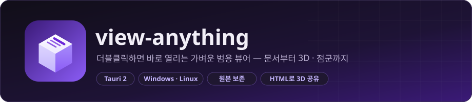
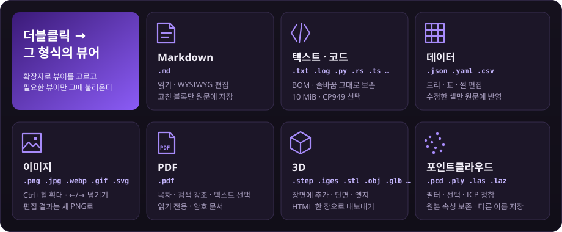
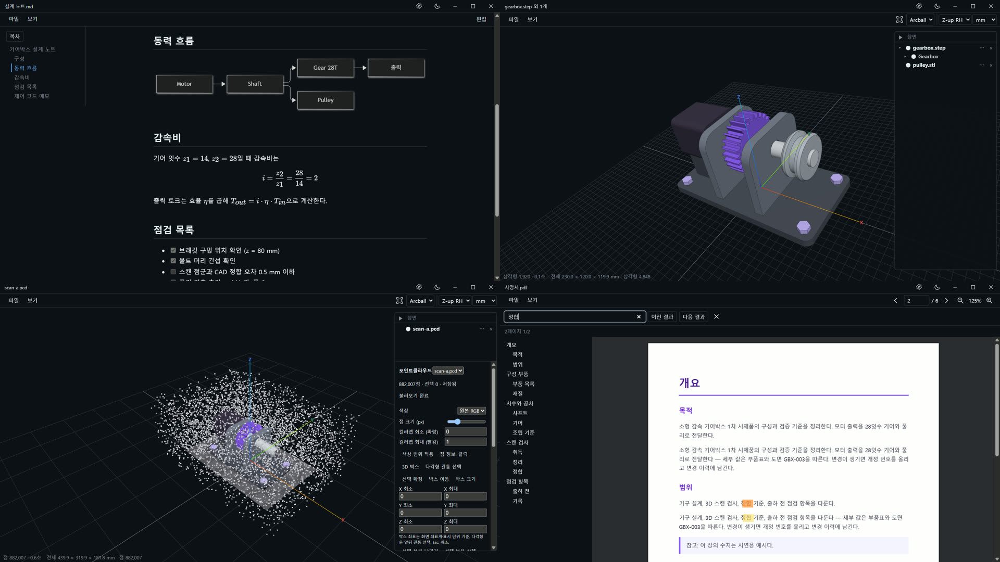
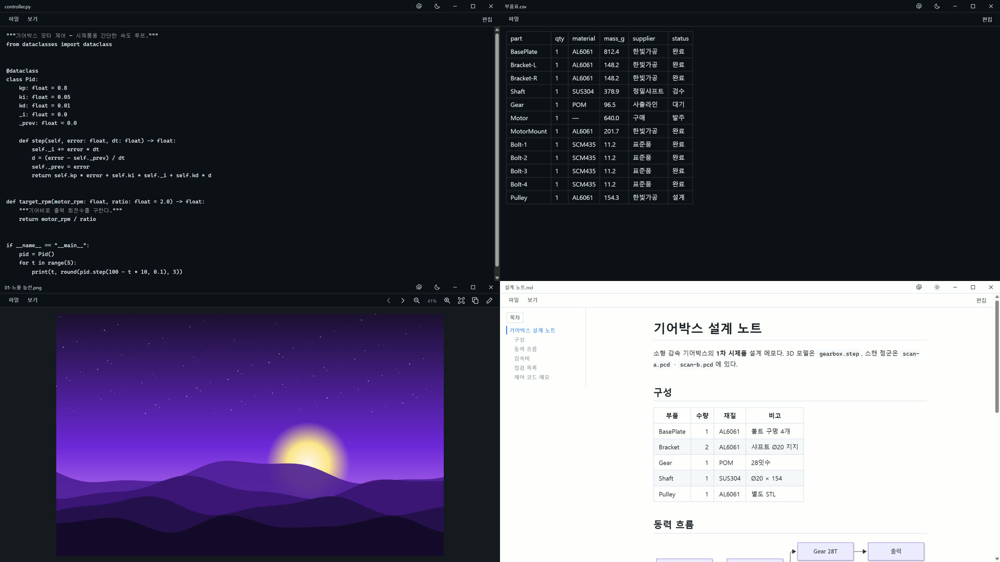
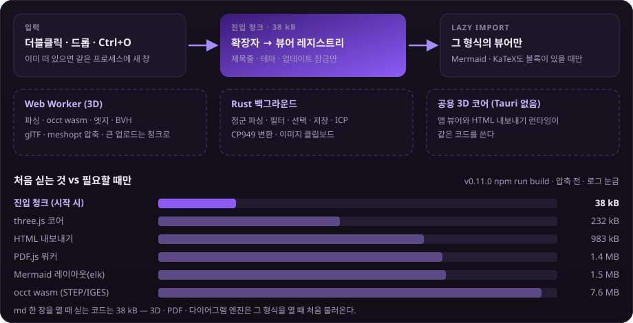

<p align="center">
  
</p>

<p align="center">
  
  
  
  
  
</p>

**view-anything**은 탐색기에서 **더블클릭하면 메모장처럼 바로 열리는** 가벼운 범용 뷰어입니다(Tauri 2). Markdown · 텍스트/코드 · JSON/YAML/CSV · 이미지 · PDF · **3D 모델** · **포인트클라우드**를 한 앱으로 읽고, 필요한 만큼만 고칩니다.

- **빠른 시작** — 확장자에 맞는 뷰어만 그때 불러옵니다. Markdown을 열 때 3D 엔진·PDF.js를 싣지 않습니다.
- **읽기와 편집 분리** — 읽기 모드에서는 내용이 바뀌지 않습니다. Markdown은 `Ctrl+E`로 Typora식 WYSIWYG 편집을 엽니다.
- **원본 보호** — Markdown은 고친 블록만, CSV는 수정한 셀만 원문에 반영합니다. 이미지·점군 편집 결과는 새 파일로 저장합니다.
- **3D를 HTML 한 장으로** — STEP 조립품에 STL을 더한 장면을 오프라인 HTML로 내보내면 앱 없이 브라우저에서 돌려 봅니다.
- **점군 정리와 정합** — PCD/PLY/LAS/LAZ의 필터·선택·강체 ICP를 Rust 백그라운드에서 처리하고, 원본 속성을 보존해 다른 이름으로 저장합니다.

## 미리보기

https://github.com/user-attachments/assets/a1ab8e74-6d9b-43c4-acfb-16e3d72ae6b8

<p align="center"><em>60초 소개 영상 — 탐색기 더블클릭으로 여는 순간(실제 속도)부터 Markdown 편집, STEP 조립품과 단면 · HTML 내보내기, 점군 필터와 ICP 정합, 이미지 · PDF까지.</em></p>

<p align="center"></p>

<p align="center"></p>

<p align="center"><em>Markdown의 Mermaid·목차, STEP 조립품에 더한 STL 풀리, 이상점이 섞인 점군 스캔, PDF 목차와 검색 강조. 화면은 v0.11.0 실제 앱이고 파일은 모두 시연용 합성 데이터입니다.</em></p>

<p align="center"></p>

<p align="center"><em>코드 파일, CSV 표, 이미지 뷰어, 라이트 테마. 모든 뷰어가 같은 제목 표시줄과 메뉴를 씁니다.</em></p>

## 빠른 시작

1. [최신 릴리스](https://github.com/rafaam11/view-anything/releases/latest)에서 설치 파일을 받습니다.
   - Windows: `view-anything_x.y.z_x64-setup.exe`(NSIS). 코드 서명 인증서가 없어 SmartScreen이 경고하면 **추가 정보 → 실행**으로 진행합니다.
   - Linux: `view-anything_x.y.z_amd64.deb` 또는 `view-anything_x.y.z_amd64.AppImage`.
2. 설치하면 지원 형식이 파일 연결됩니다. 탐색기에서 파일을 더블클릭하면 바로 열립니다. 이미 다른 앱을 연결해 둔 형식은 업데이트해도 그대로 둡니다.
3. 열린 창에서 `Ctrl+O`로 다른 파일을 열거나 파일을 끌어다 놓습니다. 3D 창에 3D 파일을 놓으면 같은 장면에 추가됩니다(`Shift`를 누르고 놓으면 새 창).

**업데이트는 자동입니다.** 시작할 때 서명된 업데이트를 확인하고, 받은 뒤에는 창 오른쪽 아래 업데이트 배지에서 재시작합니다. 재시작 전에 저장하지 않은 편집이 있으면 알리고, 취소하면 편집을 그대로 돌려줍니다. 자동 확인은 배지 메뉴의 **시작 시 업데이트 자동 확인**에서 끌 수 있습니다.

## 지원 형식

| 형식 | 확장자 | 할 수 있는 일 |
|---|---|---|
| Markdown | `.md` `.markdown` | 읽기(Mermaid · KaTeX · 목차) · WYSIWYG 편집 · 고친 블록만 저장 |
| 텍스트 · 코드 | `.txt` `.log` `.ini` `.toml` · C/C++ · Python · Rust · JS/TS 등 | 읽기 · 편집 · 검색, UTF-8/UTF-16 BOM 보존 · CP949 선택 |
| 데이터 | `.json` `.yaml` `.yml` `.csv` | 트리 · 원문 편집, CSV 표 · 셀 편집 |
| 이미지 | `.png` `.jpg` `.jpeg` `.webp` `.bmp` `.gif` `.svg` | 확대 · 이동 · 넘기기 · 복사, 회전 · 반전 · 자르기 → 새 PNG |
| PDF | `.pdf` | 읽기 전용 · 목차 · 검색 강조 · 텍스트 선택 · 암호 문서 |
| 3D | `.step` `.stp` `.iges` `.igs` `.stl` `.obj` `.ply` `.gltf` `.glb` | 장면에 추가 · 표시 모드 · 단면 · 치수 · HTML로 내보내기 |
| 포인트클라우드 | `.pcd` `.ply` `.las` `.laz` | 색 · 점 조회 · 선택 · Voxel/SOR/반경 필터 · ICP 정합 · 다른 이름 저장 |

확장자가 없거나 등록되지 않은 형식은 `Ctrl+Shift+O`의 **텍스트로 열기**로 엽니다. 일반 열기에서 미등록 형식을 고른 경우에도 **텍스트로 열기** 버튼을 제공합니다.

## 형식별 기능

### Markdown

렌더링된 화면으로 읽고, `Ctrl+E`로 Typora처럼 화면에서 바로 편집합니다. Mermaid · KaTeX · 목차를 지원하며 다이어그램과 수식 엔진은 그 블록이 있을 때만 불러옵니다.

- 저장하면 **고친 블록만** 원문에 반영합니다. 손대지 않은 블록과 frontmatter는 바이트 단위로 보존하며 회귀 테스트로 지킵니다.
- 읽기 모드에서는 다른 프로그램이 바꾼 내용을 창이 다시 활성화될 때 반영합니다.
- 편집 중 충돌이 나면 다른 이름으로 복사본을 저장할 수 있습니다. 복사본 저장은 기존 대상을 덮어쓰지 않으며 하드 링크를 지원하지 않는 파일시스템에서는 실패합니다.

### 텍스트 · 코드

TXT/LOG/INI/TOML과 C/C++ · Python · Rust · JS/TS 등 주요 코드 파일을 깔끔한 본문 화면으로 읽고 편집합니다. 저장은 파일 메뉴, 검색은 `Ctrl+F`, 인코딩 선택은 설정 안에 둡니다. 코드 실행 · 구문 강조는 제공하지 않습니다.

- UTF-8, BOM이 있는 UTF-16과 줄바꿈을 보존하며 CP949도 선택할 수 있습니다(Rust 무손실 변환).
- 혼합 줄바꿈은 읽기 전용이며 파일과 편집 결과 모두 10 MiB까지 지원합니다.
- 바이너리 · 잘못된 인코딩과 CP949로 표현할 수 없는 문자는 저장하지 않습니다. 저장은 외부 변경 · 미저장 작업을 보호하며, 복사본은 기존 대상을 덮어쓰지 않습니다.

### 데이터

JSON/YAML 트리와 원문 편집, CSV 표와 셀 편집을 지원합니다. UTF-8 및 BOM이 있는 UTF-16을 읽고, CSV는 수정한 셀 외의 원문을 보존합니다.

- 데이터 파일은 10 MiB, CSV는 100,000셀까지 엽니다. CSV는 100행 · 10열씩 표시하며 페이지를 바꿔도 편집 내용이 유지됩니다.
- 저장 전에 외부 변경을 확인하고 충돌 시 편집 내용을 유지합니다. 같은 앱의 동시 저장은 직렬화하지만, 다른 프로그램이 저장 검증과 파일 교체 사이에 쓰는 경쟁까지 파일시스템에서 원자적으로 막지는 못합니다.

### 이미지

PNG/JPEG/WebP/BMP/GIF/SVG를 아이콘 중심 화면으로 봅니다.

- `Ctrl+휠`로 포인터를 기준으로 확대 · 축소하고 드래그로 이동하며, `Ctrl+0`으로 화면에 맞춥니다. 좌우 화살표로 폴더의 이전 · 다음 이미지를 엽니다.
- `Ctrl+C`는 현재 이미지(편집했으면 편집 결과)를 원본 해상도로 클립보드에 복사합니다.
- 썸네일은 보기 메뉴에서 켜고(처음 1,000개 표시), 회전 · 반전 · 자르기는 편집 아이콘을 누른 뒤 사용합니다. 편집 결과는 원본을 보존해 PNG로 별도 저장합니다. GIF/SVG 편집 · 복사는 정적 결과입니다.
- 편집은 최대 20회 실행 취소(`Ctrl+Z`)와 다시 실행(`Ctrl+Y` 또는 `Ctrl+Shift+Z`)을 지원합니다. 편집 모드에서만 이력 아이콘이 나타나며 저장한 상태로 되돌아오면 미저장 표시도 해제됩니다. 파일을 전환하거나 원본을 다시 읽으면 이력을 초기화합니다.
- 100 MiB 및 5천만 픽셀까지 엽니다.

폴더 목록은 창을 다시 활성화할 때 갱신하며 **보기 > 목록 새로고침** 또는 `F5`로도 갱신할 수 있습니다. 현재 원본이 삭제되거나 목록 · 이미지 읽기가 실패해도 표시 중인 이미지와 미저장 편집을 유지합니다. 삭제된 원본 위치에서도 남아 있는 이전 · 다음 이미지로 이동할 수 있고, 원본 파일 · 폴더가 삭제돼도 편집 결과를 다른 PNG로 복구 저장할 수 있습니다. 원본 경로로의 저장은 계속 차단하며 끊어진 심볼릭 링크나 권한 오류는 경로를 추측해 저장하지 않습니다.

### PDF

읽기 전용 페이지 이동 · 확대, 텍스트 선택 · 복사, 검색 결과 강조와 목차를 지원합니다. 100 MiB까지 열며 현재 페이지만 렌더링합니다. 암호화된 PDF는 암호 입력 후 열 수 있고, 암호는 입력하는 동안만 보관하며 저장하거나 로그에 남기지 않습니다.

### 3D

STEP · IGES · STL · OBJ · PLY · glTF · GLB를 엽니다. 파싱 · 엣지 · BVH는 워커에서 계산하고, STEP/IGES 변환기(occt wasm)는 그 형식을 열 때만 불러옵니다.

- 끌어다 놓거나 **파일 > 장면에 추가**로 같은 장면에 더합니다. 좌표는 파일 값을 그대로 쓰므로 같은 좌표계로 만든 부품은 제자리에 붙습니다. 좌표계 프리셋을 고를 때만 변환합니다.
- 보기 메뉴에서 솔리드 · 와이어 · 솔리드+엣지 · X-ray와 X/Y/Z 단면을 고릅니다. 표준 방향은 보기 메뉴와 `1`~`7`, 전체 맞춤은 `F`입니다.
- 조작은 Arcball과 Fly 중 선택합니다. Fly에서는 장면을 드래그해 시점을 바꾸고 W/A/S/D/Q/E로 이동합니다. 장면 트리와 점군 도구는 오른쪽 패널에 있습니다.

### HTML로 내보내기

**파일 > HTML로 내보내기**(`Ctrl+Shift+E`)는 현재 장면을 오프라인 HTML 한 장으로 만듭니다. 앱과 같은 뷰어 코어를 인라인하고 geometry를 meshopt로 압축하며, 조작 모드와 카메라 상태도 담습니다. 받는 사람은 브라우저만 있으면 됩니다. 점군은 점 · 색상 · 크기만 포함되며 사용자 정의 속성이나 편집 · PCD/PLY 저장 기능은 포함되지 않습니다.

### 포인트클라우드

PCD/PLY/LAS/LAZ. 원본 RGB · 높이 · intensity 표시, 점 속성 조회, 박스 · 관통 다각형 선택, Voxel/SOR/반경 필터를 지원합니다. 원본 속성을 보존하며 같은 형식으로 다른 이름 저장합니다. 파형 · COPC와 좌표 정밀도 보존이 어려운 LAS/LAZ는 열지 않습니다.

- 장면 원본 점 합계 1천만, 디코딩 2GiB/파일, 예상 작업 메모리 8GiB/앱까지 받습니다. 필터는 **미리보기 → 결과 적용** 순서이며, 최대 20회 실행 취소 · 다시 실행을 지원합니다. 원본은 덮어쓰지 않습니다.
- 두 점군을 같은 장면에 추가한 뒤 처리할 점군과 기준 점군, 최대 대응 거리와 표본 상한(1만 · 5만 · 10만)을 지정해 강체 ICP 정합을 미리 보고 적용하거나 취소할 수 있습니다. 현재 장면 위치에서 시작하며 대응률 · RMSE · 수렴 여부를 표시합니다.
- 정합과 필터는 적용 순서대로 실행 취소 · 다시 실행할 수 있고 결과는 다른 이름으로 저장합니다. LAS/LAZ 좌표는 원본 파일의 스케일에 맞춰 양자화합니다. 정수 XYZ를 가진 PCD/PLY와 기본값이 아닌 센서 VIEWPOINT를 가진 PCD는 정합 저장을 지원하지 않습니다.

## 단축키

| 범위 | 키 | 동작 |
|---|---|---|
| 공통 | `Ctrl+O` / `Ctrl+Shift+O` | 열기 / 텍스트로 열기 |
| 공통 | `Ctrl+,` | 설정 |
| 공통 | `Ctrl+Shift+T` | 테마 순환(다크 → 라이트 → 시스템) |
| Markdown | `Ctrl+E` · `Ctrl+S` | 읽기 ↔ 편집 · 저장 |
| 텍스트 · 데이터 | `Ctrl+S` · `Ctrl+F` | 저장 · 찾기(텍스트) |
| 이미지 | `Ctrl+휠` · `Ctrl+0` · `←` `→` · `F5` | 확대 · 맞춤 · 이전/다음 · 목록 새로고침 |
| 이미지 | `Ctrl+C` · `Ctrl+Z` · `Ctrl+Y` | 원본 해상도 복사 · 실행 취소 · 다시 실행 |
| PDF | `Ctrl+F` | 찾기 |
| 3D | `1`~`7` · `F` · `Ctrl+Shift+E` | 표준 방향 · 전체 맞춤 · HTML로 내보내기 |

## 설정 · 테마

- 제목 표시줄의 설정 버튼 또는 `Ctrl+,`에서 현재 뷰어에 맞는 항목을 엽니다. Markdown과 텍스트의 글꼴(시스템 · 명조 · 고정폭) · 크기(12~24px)를 각각 설정하고, 텍스트는 자동 줄바꿈도 선택합니다. 읽기 · 편집에 함께 적용하고 열린 창에 동기화하며 재시작 후에도 유지합니다. 빈 창에서는 두 표시 설정을 모두 제공하고, 다른 뷰어에서는 테마 같은 공통 설정만 표시합니다.
- 우측 상단 창 버튼 왼쪽의 버튼으로 다크 → 라이트 → 시스템 순서로 바꿉니다. 설정을 기억하고 열린 창에 동기화합니다.
- 모든 뷰어는 같은 높이의 상단 메뉴와 공통 버튼 · 입력창 스타일을 사용합니다. 저장 · 복사본은 파일 메뉴에, 검색은 필요할 때만 여는 검색창에 두고 파일명을 본문에 중복 표시하지 않습니다.

## 구조와 안전장치

<p align="center"></p>

- 확장자 → 뷰어 레지스트리로 연결하고 뷰어를 lazy import합니다. 진입 청크와 Markdown 뷰어 청크는 three · occt를 정적으로 참조하지 않으며 `npm run check:bundle`이 이를 검사합니다.
- 무거운 계산은 3D는 Web Worker에서, 포인트클라우드는 Rust 백그라운드(`spawn_blocking`, kiddo + rayon)에서 합니다.
- 저장 직전에 디스크 바이트를 확인하고 네이티브 조건부 원자 교체로 씁니다. 창을 닫거나 업데이트로 재시작할 때 미저장 작업을 먼저 확인합니다.
- 업데이트 중에는 앱 단축키 · 열기 · 드롭 · 설정 변경을 막고, 취소하면 기존 상태와 미저장 편집을 그대로 돌려줍니다. 파일 연결은 업데이트해도 사용자가 고른 다른 앱을 유지하고, 제거할 때는 우리 연결인 경우에만 복원합니다.

> 설계는 [docs/superpowers/specs](docs/superpowers/specs/2026-10-26-view-anything-design.md)를 참고하세요.

## 개발

```sh
npm install
npm run tauri dev
```

- 빌드: `npm run tauri build`
- 검증: `npm test`, `npx tsc --noEmit`, `npm run build`, `npm run check:bundle`, `cargo test --manifest-path src-tauri/Cargo.toml`

설치 · 업데이트와 Linux 패키지 GUI 회귀는 GitHub Actions의 **desktop** workflow로 실행합니다. 일회용 GitHub-hosted 환경에서 시험용 NSIS/deb/AppImage를 만들며 운영 키와 공개 릴리스는 사용하지 않습니다. 화면 · 클립보드 · 파일 저장 · 설치 결과는 실행의 evidence artifact에 남깁니다. [검증 구성과 범위](docs/superpowers/plans/2026-10-29-desktop-lifecycle.md)를 참고하세요.

Windows 설치 · 서명 업데이트 · 제거와 Linux deb/AppImage의 실제 WebView · 네이티브 저장창 · 이미지 클립보드 회귀를 통과했습니다. [검증 결과와 한계](docs/superpowers/plans/2026-10-29-desktop-checklist.md)에 단위 테스트 · GUI 자동 조작 · 물리 데스크톱 검증을 구분했습니다.

## 릴리스 노트

- [v0.11.0](docs/release/v0.11.0.md) — 최신
- [v0.10.0](docs/release/v0.10.0.md)
- [v0.9.0](docs/release/v0.9.0.md)
- [v0.8.0](docs/release/v0.8.0.md)
- [v0.7.0](docs/release/v0.7.0.md)
- [v0.6.1](docs/release/v0.6.1.md)
- [v0.6.0](docs/release/v0.6.0.md)
- [v0.5.1](docs/release/v0.5.1.md)
- [v0.5.0](docs/release/v0.5.0.md)
- [v0.4.2](docs/release/v0.4.2.md)
- [v0.4.1](docs/release/v0.4.1.md)
- [v0.4.0](docs/release/v0.4.0.md)
- [v0.3.0](docs/release/v0.3.0.md)
- [v0.2.0](docs/release/v0.2.0.md)
- [v0.1.0](docs/release/v0.1.0.md)
