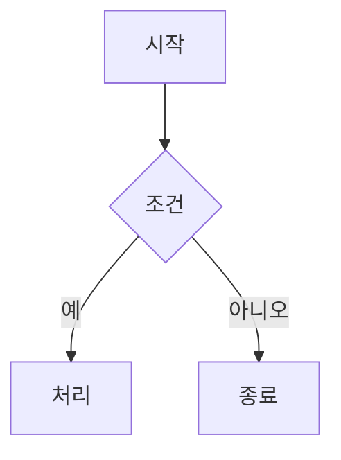

# 샘플 문서

view-anything 읽기 모드 확인용 문서입니다. [다음 절](#표)로 이동하거나 [외부 링크](https://example.com)를 열어 보세요.

## 표

| 이름 | 값 | 설명 |
| ---- | -- | ---- |
| a | 1 | 첫째 |
| b | 2 | 둘째 |

## 코드

```ts
function add(a: number, b: number): number {
  return a + b; // sum
}
```

## 수식

인라인 $E = mc^2$ 그리고 블록:

$$
\int_0^1 x^2\,dx = \frac{1}{3}
$$

## 다이어그램



## 이미지


> 인용문 예시

- 목록 하나
- 목록 둘
